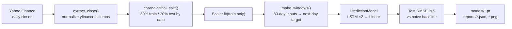

# Stock Price Forecasting with an LSTM (PyTorch)

[](https://github.com/EricValentino/stock-price-lstm/actions/workflows/ci.yml)

A small, reproducible time-series experiment. A two-layer LSTM predicts a stock's next-day closing price from the previous 30 days. The model is evaluated on a held-out, later period against the simplest possible baseline: "tomorrow's close equals today's."

The point of the project is the methodology rather than a trading signal. That means a strict chronological split, no information leaking from the test period, metrics reported in dollars, and an honest comparison with a baseline that is notoriously hard to beat on daily prices.

## Pipeline



## Model

| Setting | Default | Flag |
|---|---|---|
| Input window | 30 trading days | `--window` |
| LSTM layers / hidden units | 2 / 32 | `--layers`, `--hidden` |
| Loss / optimizer | MSE / Adam, lr 1e-3 | `--lr` |
| Training | 200 epochs, mini-batches of 64 | `--epochs`, `--batch-size` |
| Split | first 80% of days train, last 20% test | `--train-frac` |
| Seed | 42 | `--seed` |

## Methodology notes

- **No look-ahead in scaling.** The standardization mean and standard deviation are computed from training prices only. Fitting on the full series would leak the test period's level and volatility into training.
- **Chronological split.** Test windows may look back into the final 30 training days, because that history is available at prediction time, but no test target is ever seen during training.
- **Baseline first.** Daily prices are close to a random walk, so a naive persistence forecast is a strong benchmark. `train.py` prints and saves both RMSEs so the comparison is never hidden.
- **Robust to yfinance changes.** Newer yfinance releases return multi-level columns even for one ticker, which used to turn the input into a 4-D tensor and crash training. `extract_close()` normalizes this, and a regression test covers it.

## Quick start

Requires Python 3.10+.

```bash
git clone https://github.com/EricValentino/stock-price-lstm.git
cd stock-price-lstm
python3 -m venv .venv && source .venv/bin/activate
pip install -r requirements.txt

python src/train.py --ticker MSFT --start 2020-01-01
python src/predict.py --ticker MSFT
```

`train.py` writes:

- `models/msft_lstm.pt`: weights, scaler parameters and hyperparameters, everything `predict.py` needs
- `reports/msft_metrics.json`: test RMSE for the LSTM and the naive baseline, plus the full config
- `reports/msft_test.png`: actual vs predicted vs baseline over the test period

Run `python src/train.py --help` for all options.

## Results

Results depend on the ticker, date range and seed, so none are hard-coded here. Run the training script to generate the metrics file and plot for your configuration. Beating the naive baseline on daily prices is genuinely difficult, so the two numbers should be read side by side.

## Testing

```bash
pip install -r requirements-dev.txt
pytest -q
ruff check . && ruff format --check .
```

- `tests/test_data.py` covers windowing alignment, scaler leakage, split boundaries, yfinance column handling and RMSE. It needs only NumPy and pandas.
- `tests/test_model_and_training.py` covers model shapes, input validation, and an end-to-end training run on a synthetic price series (no network). It requires PyTorch and is skipped if PyTorch isn't installed.

CI installs CPU-only PyTorch and runs lint plus the full suite on every push and pull request.

## Repository structure

```
stock-price-lstm/
├── src/
│   ├── data.py        # download, preprocessing, split, metrics (pure NumPy/pandas)
│   ├── model.py       # LSTM definition
│   ├── train.py       # training + evaluation CLI
│   └── predict.py     # next-day prediction from a saved checkpoint
├── tests/
├── requirements.txt
├── requirements-dev.txt
└── .github/workflows/ci.yml
```

## Limitations and future work

- Single feature (close price). Volume, returns and technical indicators are natural next inputs.
- Predicting returns instead of price levels would make errors comparable across tickers and price regimes.
- Walk-forward (rolling-origin) evaluation would give a more reliable error estimate than one split.
- Candlestick charts for the report plot.
- A Transformer-based model as a comparison point.

## License

MIT. See [LICENSE](LICENSE).

---

*Educational project; not financial advice.*
